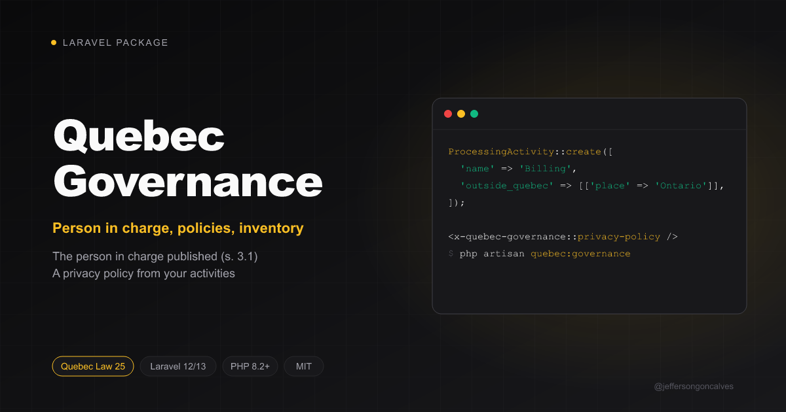

# Laravel Quebec Governance



[](https://packagist.org/packages/jeffersongoncalves/laravel-quebec-governance)
[](https://github.com/jeffersongoncalves/laravel-quebec-governance/actions/workflows/tests.yml)
[](https://packagist.org/packages/jeffersongoncalves/laravel-quebec-governance)

Governance under Quebec's private sector privacy act (Law 25). It is part of the [laravel-quebec](https://github.com/jeffersongoncalves/laravel-quebec) suite.

Law 25 asks every business to:

- have a **person in charge of the protection of personal information**: by default the person with the highest authority, who can delegate the function in writing. Publish their title and contact information on your website (s. 3.1);
- adopt **governance policies and practices**, covering the roles and responsibilities of personnel, the keeping and destruction of information, and how complaints are handled, and publish detailed information about them in clear and simple terms (s. 3.2);
- publish a **privacy policy** in clear and simple terms when it collects personal information through technological means (s. 8.2), and tell persons the purposes, the recipients, whether information may be communicated outside Quebec, and their rights (s. 8).

This package keeps an inventory of your processing activities, joined with the personal information you declared with [laravel-quebec](https://github.com/jeffersongoncalves/laravel-quebec), and renders the privacy policy and the person in charge from it.

> This package gives you tooling. It does not make you compliant on its own. You still need legal review, for example to write your governance policies.

## Installation

```bash
composer require jeffersongoncalves/laravel-quebec-governance
php artisan vendor:publish --tag="quebec-governance-migrations"
php artisan migrate
php artisan vendor:publish --tag="quebec-governance-config"
```

Set the business, the person in charge and your governance policies in `config/quebec-governance.php` (or the `QUEBEC_*` environment variables).

## Usage

```php
use JeffersonGoncalves\QuebecGovernance\Models\ProcessingActivity;

ProcessingActivity::create([
    'name' => 'Billing',
    'purpose' => 'Issue invoices',
    'persons' => ['customers'],
    'models' => [Customer::class],          // their #[PersonalData] columns join the inventory
    'recipients' => [['name' => 'Stripe', 'role' => 'service_provider']],
    'outside_quebec' => [['place' => 'United States', 'pia' => true]],   // s. 17: assess first
    'retention' => '6 years',
]);
```

```php
use JeffersonGoncalves\QuebecGovernance\Facades\QuebecGovernance;

QuebecGovernance::export();          // business, person in charge, policies, activities
QuebecGovernance::personInCharge();
QuebecGovernance::gaps();            // missing person in charge, policies, or a PIA before communicating outside Quebec
```

```bash
php artisan quebec:governance          # table + gaps
php artisan quebec:governance --json
```

### Blade components

```blade
<x-quebec-governance::privacy-policy rights-url="/privacy/requests" />
<x-quebec-governance::person-in-charge class="footer" />
```

The privacy policy ships in English and French. It mentions profiling technology when a declared column has `profiling: true` (s. 8.1), and points to the Commission d'accès à l'information for complaints. Publish the translations to change the wording: `php artisan vendor:publish --tag="quebec-governance-translations"`.

## Testing

```bash
composer test
```

## Changelog

See [CHANGELOG](CHANGELOG.md).

## License

The MIT License (MIT). See [License File](LICENSE.md).
